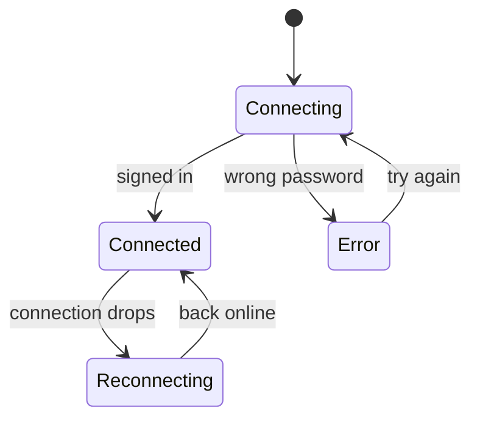

# Avio

<p align="center">
  
</p>

## Your chats. Your server. Your rules.

> **Not ready for production.** Avio is a development preview at **0.1.0-dev.0**.
> Features, interfaces, storage formats, and XMPP behavior may change without notice.
> Use it for evaluation and development only; do not rely on it for important
> accounts or sensitive conversations yet.

Avio is a fast, friendly messaging app for the open network. It runs in your browser
and on your desktop, connects straight to the server you choose, and reaches anyone
on any server. No middleman. No lock-in.

It is built on XMPP, the open standard that works like email. Your address belongs
to you, your conversations live on your server, and the network is open to everyone.

---

## Why Avio

**Fast.** Messages appear the moment you press Enter. The ticks catch up on their
own. When the network drops, Avio reconnects quietly and the conversation carries on.

**Federated.** Your address can talk to an address anywhere else. Different server,
different country, different operator — it all works the way email does.

**Self-hosted.** Run your own server, host the app on your own domain, and give your
people addresses you control. Or join a server someone else already runs. The choice
is yours.

**Simple.** Sign in with an address and a password. That is the whole setup. The
layout is familiar, the keyboard works the way you expect, and the advanced settings
stay out of the way until you need them.

## Federated, like email

Most chat apps give you a username inside their building. Avio gives you an address
on the open network: `you@your-domain.com`. A friend on another server is still one
message away, and neither server needs permission from a platform to deliver it.


That is the whole idea. You choose where your side of the conversation lives. Nobody
else has to choose the same place.

## Self-host the whole thing

Avio is a client, not a platform. There is no Avio service between you and your
messages.

- Run your own XMPP server — Prosody, ejabberd, or any standards-compliant server —
  and point Avio at it.
- Host the web app on your own domain, next to your server.
- Give your household, team, or community addresses you control.
- Keep the desktop app on the same server, with the same account.
- Skip the server when you do not want one: sign in to a friend's or community's
  server and use Avio like any other messenger.

Self-hosting is a choice here, not a requirement. Avio works the same either way.

For server operators: Avio needs a browser-friendly endpoint (WebSocket or BOSH) and
your app's origin allowed. When discovery is not configured, the advanced fields take
the endpoint directly. See [`docs/connections.md`](docs/connections.md) for server
configuration, discovery, Tauri, and troubleshooting.

## Fast, in practice

- **Send and move on.** Your message is on screen immediately, with delivery ticks
  following as the server and the other side catch up.
- **Reconnect without drama.** Close the lid, walk into a lift, lose Wi-Fi. Avio
  reconnects on its own and picks up where the conversation stopped.
- **Follow your conversations across devices.** A reply sent from your phone is
  already there on your laptop, and the other way around.
- **Scroll without losing your place.** History loads around you, the transcript
  holds still, and a jump-to-latest button appears when you drift away.
- **See what is happening now.** Presence, typing indicators, unread counts, and read
  receipts update as they happen, not on a refresh.



A dropped connection is a pause, not an interruption.

## Simple by default

- Sign in with your address and password. There is nothing else to configure.
- Advanced connection settings exist for servers that need them. Most people never
  open that panel.
- Enter sends. Shift+Enter starts a new line.
- Conversations sit on one side, the chat on the other, and the whole thing folds
  into a comfortable layout on a phone.
- The browser and desktop apps use the same account and show the same conversations,
  so switching between them changes nothing.

## Private by default

- Your password is kept only in tab-scoped session storage so a refresh can restore
  the session. It is never written to `localStorage`, and it is cleared on logout and
  auth failure. The Tauri build will use the OS keychain.
- Avio remembers your address and connection details on your device, and nothing more.
- **End-to-end encryption is not implemented yet.** Messages are protected in
  transit by TLS, but the server can read them. OMEMO is planned and is not
  enabled.
- Messages render as plain text. Nothing inside a message can execute in your app.
- Your history lives on your server, under your rules. Back it up, move it, or delete
  it on your own terms.
- There is no Avio backend in the path. Your messages go from your device to your
  server, and nowhere else.

## Desktop, when you want it

Avio for desktop is the same client in a window of its own, built with Tauri. It uses
your system's web engine, so it stays small and starts fast — no bundled browser, no
second account, no background service.

The web app is the full product. The desktop app is simply the comfortable way to keep
Avio open all day.

## Get started

All you need is an XMPP address and its password.

1. Open Avio.
2. Enter your address, your password, and — if your server needs it — the connection
   address.
3. Start talking.

## Run Avio yourself

```bash
pnpm install
pnpm dev
```

Avio runs at `http://localhost:3000`. The web build is a front end you host yourself;
there is no Avio messaging backend to deploy. The desktop build wraps the same client
with Tauri.

## Under the hood

Standard XMPP over WebSocket or BOSH, with stream resumption, message carbons, and
delivery receipts. No proprietary server extensions, no vendor account, no relay
between you and your server.

---

Avio is in active development, with the web client as the reference implementation
and the desktop app built from that same client.

## Versioning

Avio uses [Semantic Versioning](https://semver.org/). The current release is
`0.1.0-dev.0`. Before `1.0.0`, preview releases may include breaking changes to
storage, configuration, and UI. See [`CHANGELOG.md`](CHANGELOG.md) for what changed.

## License

Avio is free software: you can redistribute it and/or modify it under the terms
of the GNU General Public License as published by the Free Software Foundation,
version 3.

Avio is distributed in the hope that it will be useful, but WITHOUT ANY WARRANTY;
without even the implied warranty of MERCHANTABILITY or FITNESS FOR A PARTICULAR
PURPOSE. See the [GNU General Public License v3](LICENSE) for details.

Copyright (C) 2026 Avio contributors.
